# kicad-mcp

**An MCP server that lets an AI agent design real, manufacturable PCBs.** The agent decides what a human electronics engineer decides: parts, connections, reference circuits, design rules, floorplan, and which parts must sit close to which pins. Deterministic engines turn that intent into a KiCad 10 project:

- a hierarchical schematic
- double-sided placement
- human-like routing with coupled differential pairs and length tuning
- copper pours
- DRC/ERC, Gerbers, BOM and pick-and-place

Everything runs headless.

It was built and evaluated by designing a **130-part Rockchip RV1106 Linux single-board computer from scratch** (`designs/rv1106-sbc/`):

- 4-layer, 65 × 50 mm
- USB-C, 10/100 Ethernet, SPI NAND, microSD, MIPI-CSI, 4 regulators
- **KiCad ERC 0 errors; DRC 0 errors, 0 warnings, 0 unconnected, 0 schematic-parity issues**
- differential pairs length-matched with 45°-mitred serpentines (0.15–0.4 mm; ETH RX 1.96 mm)
- expert finishing: fiducials, labelled test points, edge via fence, legalised silkscreen

See [`docs/EVALUATION.md`](docs/EVALUATION.md).

| | |
|---|---|
| [`AGENTS.md`](AGENTS.md) | **Playbook for the AI agent**: the step-by-step flow, design rules and pitfalls that produce high-quality boards |
| [`docs/TOOLS.md`](docs/TOOLS.md) | Reference for all 26 MCP tools (generated from the server) |
| [`docs/ARCHITECTURE.md`](docs/ARCHITECTURE.md) | How it works: IR, placer, routers (own C++ router + Freerouting), verification |
| [`docs/EVALUATION.md`](docs/EVALUATION.md) | The RV1106 case study: metrics, iterations, bugs found, honest limitations |
| [`designs/rv1106-sbc/`](designs/rv1106-sbc) | Complete worked example: IR, KiCad files, every MCP call batch, fab outputs, renders |


## Gallery: the RV1106 example, generated end to end through the MCP tools

| PCB, top (3D) | PCB, bottom (3D): decoupling and crystal under the SoC |
|---|---|
| 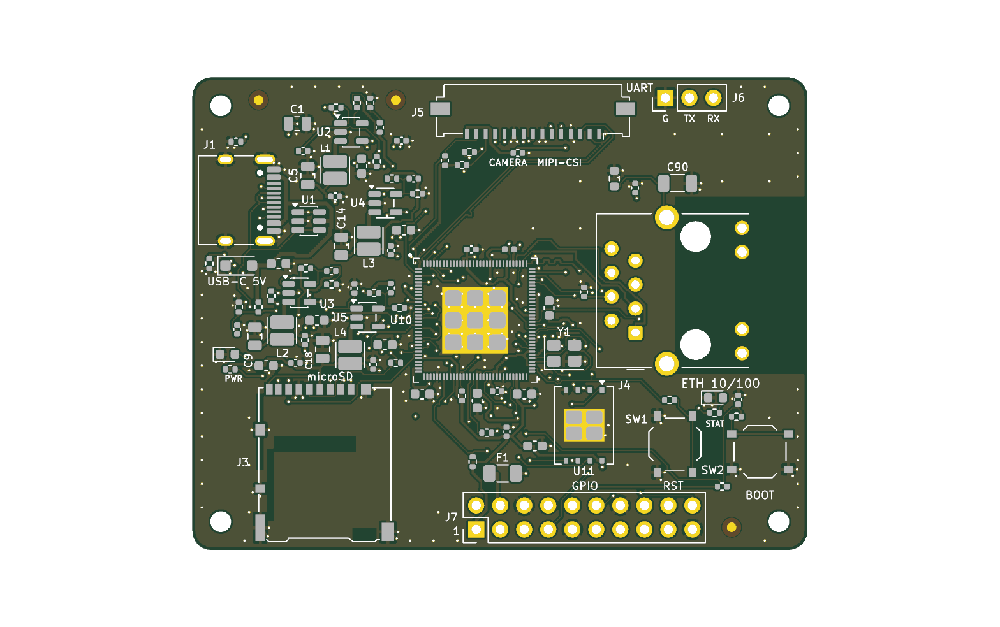 | 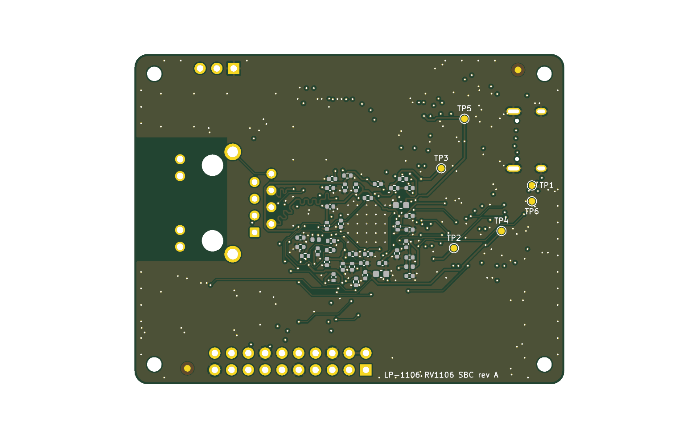 |

| Layout: red F.Cu, olive In2.Cu, blue B.Cu; hatched = bottom-side parts | Length tuning: serpentine meanders on the CSI camera pairs |
|---|---|
| 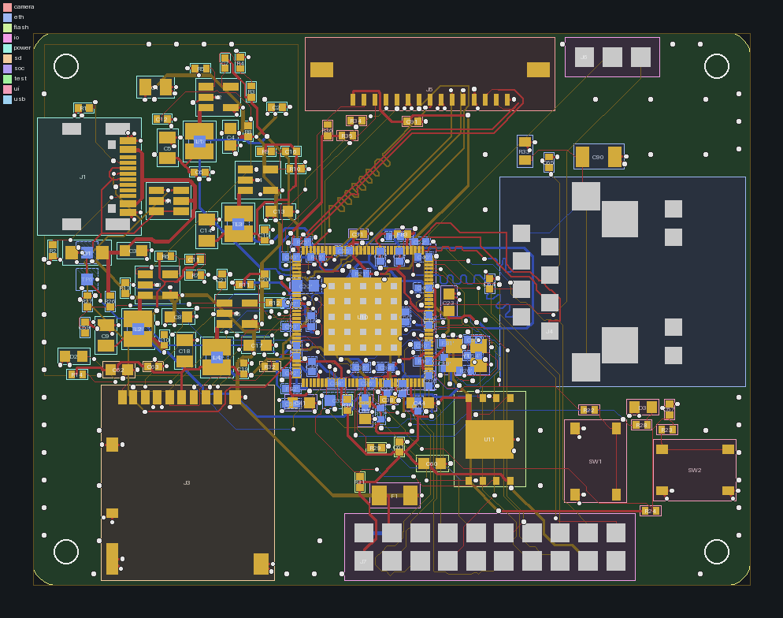 | 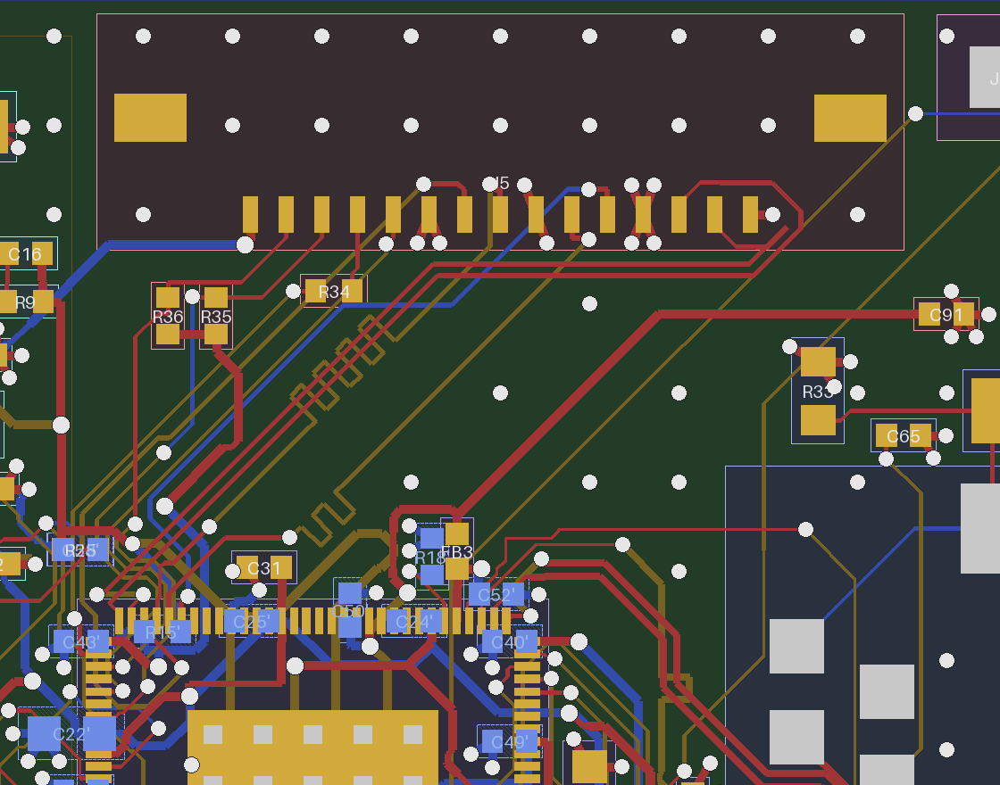 |

Generated hierarchical schematic, one sheet per functional block (ERC 0 errors, netlist identical to the design IR):

| SoC sheet: RV1106G3 symbol generated from the datasheet pin table | Power sheet: 4 bucks with E96 feedback dividers, USB-C sink, ESD |
|---|---|
| 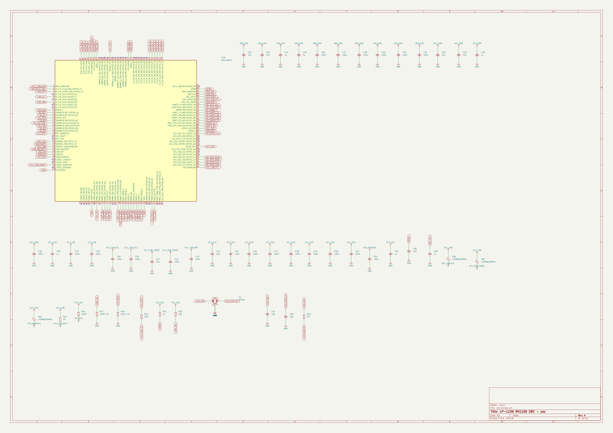 | 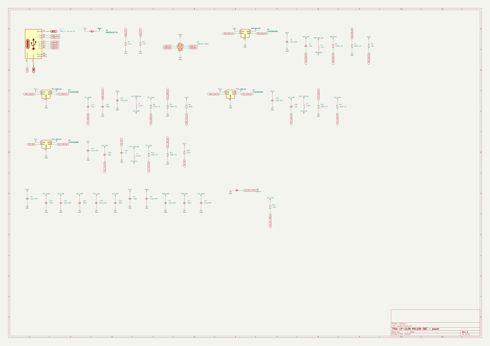 |

| Ethernet sheet | Camera sheet | Root sheet |
|---|---|---|
| 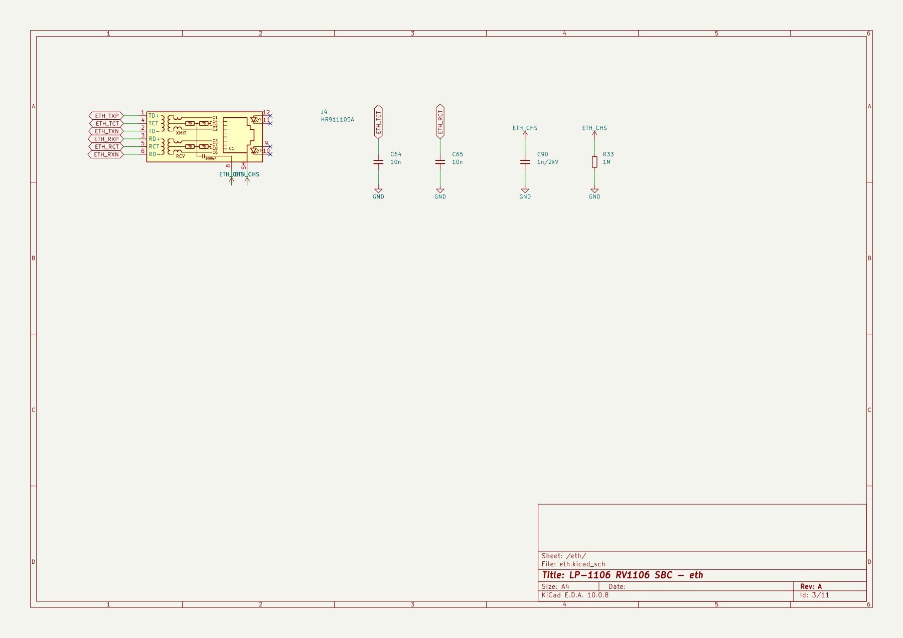 | 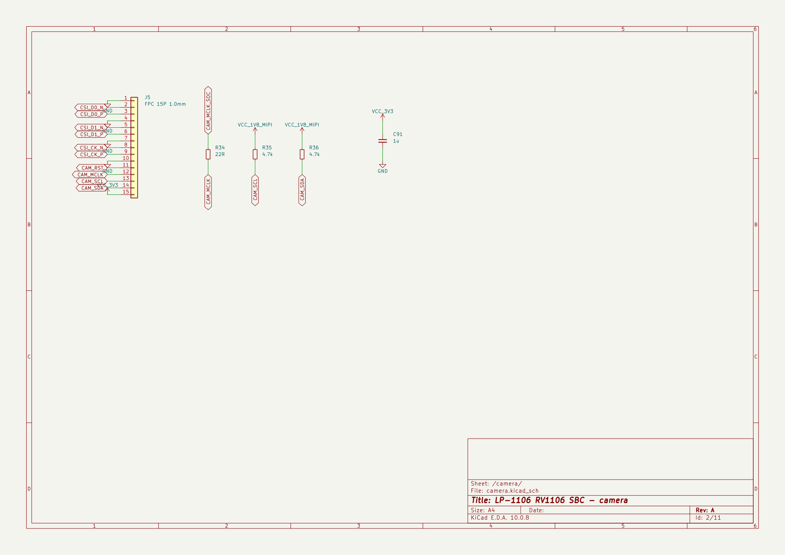 | 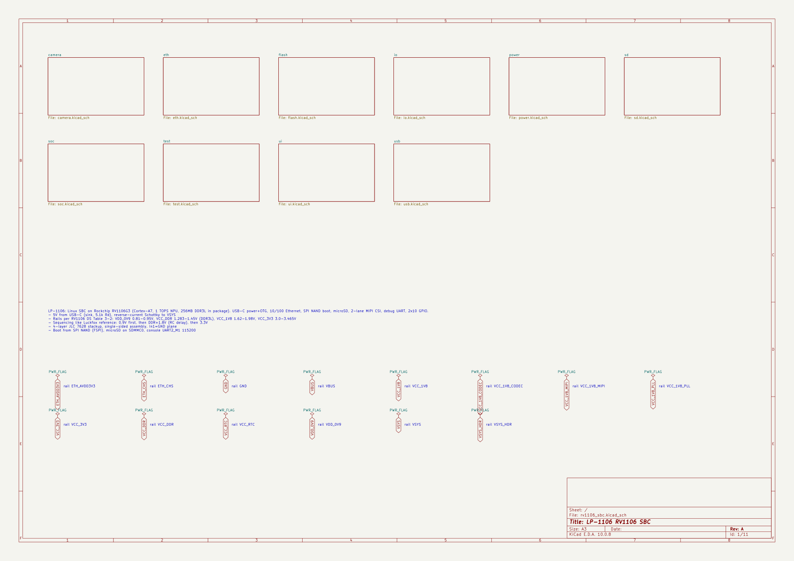 |

<details><summary>v1 for comparison: single-sided, Freerouting only</summary>

| | |
|---|---|
| 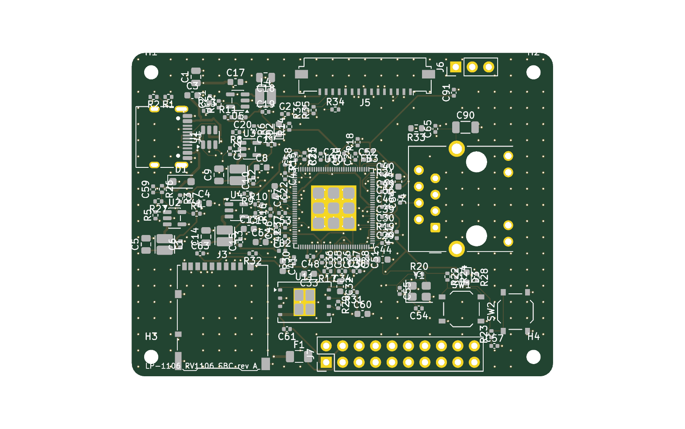 | 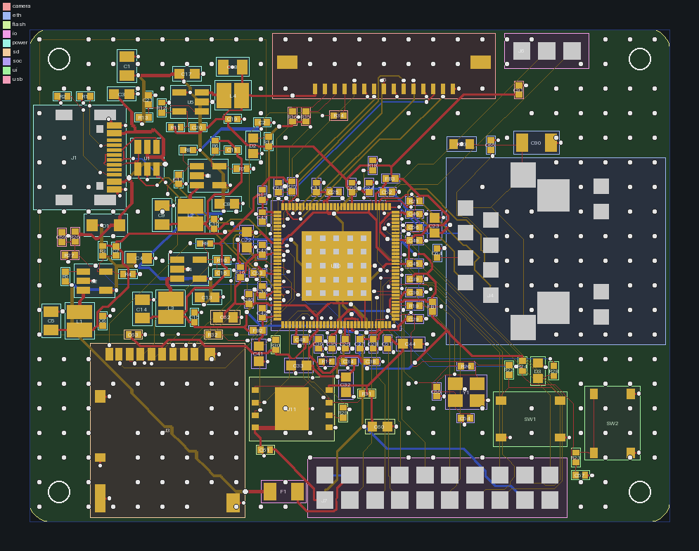 |

</details>

---

## 1. Install (Linux x86_64, no sudo needed)

```bash
git clone git@github.com:nikhilrayaprolu/kicad-mcp.git
cd kicad-mcp
./scripts/install.sh
```

`install.sh` is idempotent and installs everything into the repo folder:

| Step | What |
|---|---|
| pixi env | Python 3.12, Java 25, `mcp`, numpy, scipy, shapely, pymupdf, … (installs pixi itself if missing) |
| KiCad 10.0.8 | `kicad-cli` and the stock symbol/footprint libraries, unpacked from the official KiCad PPA into `tools/kicad-root`, with the shared libraries it needs (tested on Ubuntu 24.04) |
| Freerouting 2.5 | `tools/freerouting/freerouting-2.5.0.jar` |
| hroute | builds the C++ router `router_cpp/hroute` (needs `g++`) |
| smoke test | `pixi run test`: 12 tests, including routed boards that must pass KiCad DRC |

If you already have **KiCad ≥ 9** (`kicad-cli` on PATH, libraries in `/usr/share/kicad`), run `SKIP_KICAD=1 ./scripts/install.sh`. On a non-Ubuntu distro, install KiCad from your package manager or Flatpak, then use `SKIP_KICAD=1`.

Hardware: any modern CPU works. Placement and routing portfolios scale with cores: 64 placement chains and 16–32 routing jobs run concurrently, about 0.4 GB RAM each. A 130-part board takes about 1–1.5 h end to end on 80 cores.

## 2. Connect it to your agent

**Claude Code:**

```bash
claude mcp add -s user kicad-mcp -- bash -c 'source /path/to/kicad-mcp/tools/env.sh && exec /path/to/kicad-mcp/.pixi/envs/default/bin/python -m llmpcb.server'
claude mcp list        # kicad-mcp: … ✔ Connected
```

**Any other MCP client** (Claude Desktop, Cursor, custom agents): it is a stdio server.

```json
{
  "mcpServers": {
    "kicad-mcp": {
      "command": "bash",
      "args": ["-c", "source /path/to/kicad-mcp/tools/env.sh && exec /path/to/kicad-mcp/.pixi/envs/default/bin/python -m llmpcb.server"]
    }
  }
}
```

Give the agent [`AGENTS.md`](AGENTS.md). In Claude Code, opening a session in this repo loads `CLAUDE.md` → `AGENTS.md`, and the `pcb-design` skill (`.claude/skills/pcb-design/`) is picked up automatically. With other agents, paste `AGENTS.md` into the system prompt or project instructions. The server also sends a condensed version as its MCP `instructions`.

**Scripted use, without an LLM client.** Run tool-call batches over real MCP stdio, which is how the example board was made:

```bash
pixi run python clients/mcp_call.py designs/myboard calls.json      # calls.json = [{"tool": ..., "args": {...}}, ...]
pixi run python clients/metrics.py designs/myboard                  # tool calls, latency, response sizes, DRC/ERC
```

## 3. How to ask for a board (for users)

The quality of the board depends mostly on the quality of your request. A good request contains:

1. **Function and interfaces:** "Linux SBC on RV1106G3 with USB-C power + USB2 device, 10/100 Ethernet (RJ45 with magnetics), SPI-NAND boot, microSD, 2-lane MIPI camera FPC, debug UART header, 2×10 GPIO header."
2. **Power:** input source and voltage, every rail with its voltage and estimated current, and sequencing if the chip needs it.
3. **Mechanics:** board size limit, connector edges, mounting holes, height limits, and whether **double-sided assembly** is allowed. That is recommended for fine-pitch SoCs: decoupling goes under the chip.
4. **Fab target:** e.g. JLCPCB 4-layer 1.6 mm (the default preset), and impedance targets for high-speed pairs.
5. **Sources:** datasheets and a reference-design schematic for every complex IC. The agent extracts pin tables into `knowledge/*.yaml` with page citations. Reference designs are the fastest way to correct support circuits.

Example prompt:

> Using the kicad-mcp server and AGENTS.md, design a 4-layer 50×40 mm ESP32-S3 board: USB-C 5 V in, 3.3 V/1 A buck, USB D+/D− to the S3 with ESD, 16 MB flash + 8 MB PSRAM (module), I2C header, 2 buttons, RGB LED, 4 M2 holes. Double-sided assembly allowed for passives. Target JLCPCB. Show me the placement render before routing, and stop only at DRC 0/0.

What you will see from the agent:

1. requirements and parts, then **schematic + ERC**
2. board setup, then **placement render**
3. **routing portfolio** (hybrid), then **DRC**
4. repair passes, then **length tuning**, then **design review**
5. **fab export + 3D renders**

You can intervene at any stage. For example: "move the USB connector to the bottom edge", "allow the crystal on the bottom side", "make VSYS 1 A", "route the camera pairs as coupled pairs".

Open the result in KiCad 10: `designs/<name>/<name>.kicad_pro`. The library tables in the project point at `llmpcb/library` for generated parts. After hand edits in KiCad, the agent can pull them back with `sync_from_kicad`.

### Quality checklist before ordering

- [ ] `schematic_build`: ERC 0 errors, `netlist_parity.ok`
- [ ] `drc`: 0 errors, 0 unconnected, 0 parity; remaining warnings explained (pour islands, silkscreen)
- [ ] `design_review`: no errors; each `near`/`current`/`escape`/`diffpair` warning judged
- [ ] Generated footprints (`llmpcb/library`) checked against the manufacturer's land pattern
- [ ] I/O voltage domains, power sequencing and regulator choices reviewed by a human
- [ ] 3D renders (top and bottom) look right; connectors face the board edge

## 4. What is inside

| Layer | Implementation |
|---|---|
| Design IR | `design.json` (components, pin→net, netclasses, constraints, board) + `layout.json` (placement incl. side, tracks, vias, zones). KiCad files are regenerated from these. |
| Parts & knowledge | KiCad 10 stock libraries; curated parts with design facts; generated symbols/footprints from datasheet pin tables (`knowledge/*.yaml`) |
| Reference blocks | buck (E96 divider + sequencing RC), decoupling, crystal (CL→Cload), USB-C sink + ESD + pair, LED, button, … |
| Schematic | hierarchical sheets per block, labels at pin endpoints, PWR_FLAGs, ERC + netlist parity via `kicad-cli` |
| Placement | double-sided, rigid cluster macros, simulated annealing + legalisation + refinement, 64-seed parallel portfolio |
| Routing | **hroute** (own C++ router: 45°, negotiated congestion, neck-down, coupled diff pairs) + Freerouting; hybrid critical-first portfolio; DRC-scored parallel repair; serpentine length tuning |
| Verification | `kicad-cli` ERC/DRC (zones refilled, schematic parity), design review (decoupling distance, crystal, diff-pair skew, IPC-2221 current, escape feasibility) |
| Output | Gerber X2, Excellon, CPL, JLC BOM, IPC-D-356, PDFs, 3D renders |

Why it writes KiCad files directly instead of using `pcbnew`/IPC: KiCad 10's IPC API needs a running GUI, and the SWIG `pcbnew` module is deprecated. kicad-cli is used as the verifier, and the writers are checked against KiCad itself. See `docs/ARCHITECTURE.md`. An optional `ipc_sync` tool pushes to or pulls from a running KiCad GUI.

## 5. Development

```bash
source tools/env.sh
pixi run test                                   # unit + end-to-end (route -> KiCad DRC clean)
pixi run python clients/gen_tool_docs.py        # regenerate docs/TOOLS.md after changing tools
g++ -O3 -march=native -std=c++17 -o router_cpp/hroute router_cpp/hroute.cpp
```

Router debugging (`router_cpp/hroute.cpp`, problem files in `designs/<x>/out/hroute/*/problem.txt`):

| Variable | Effect |
|---|---|
| `HROUTE_PROBE="net layer x y"` | ASCII legality map around a point |
| `HROUTE_DBG=1` | failed-search statistics and flood-fill reachability |
| `HROUTE_BUDGET` | negotiation time budget, in seconds |
| `HROUTE_CAP` | A* expansion cap |
| `HROUTE_SEQ=1` | legacy sequential rip-up |

## Limitations (honest)

- **hroute's completion:** it completes 75–80 of 84 nets on the dense RV1106 board; Freerouting finishes the rest in hybrid mode. Its strength is critical nets and coupled pairs.
- **Coupled pairs** survive only where the placement leaves a corridor. Others are routed single-ended and then length-tuned.
- **Generated footprints** (e.g. the QFN-128) are derived from datasheet drawings and must be verified.
- **Not covered:** high-speed DDR fan-out, impedance field solving, SI/PI/thermal simulation.
- **IPC live mode** is implemented but untested, since there was no KiCad GUI in the development environment.
